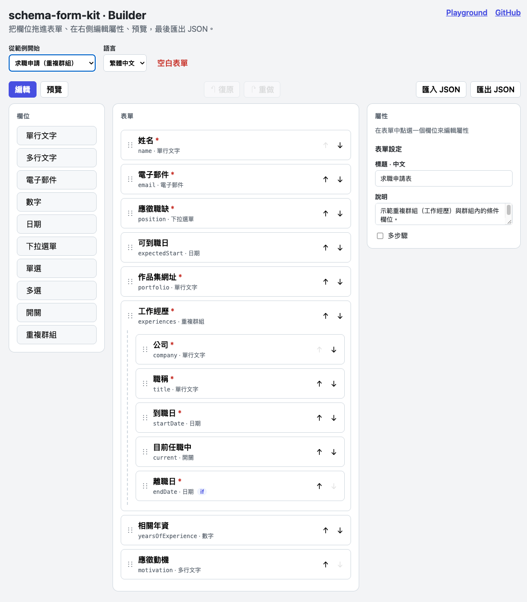
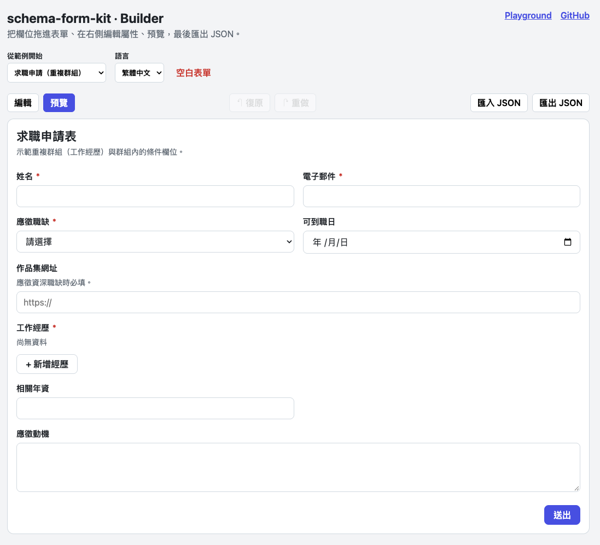
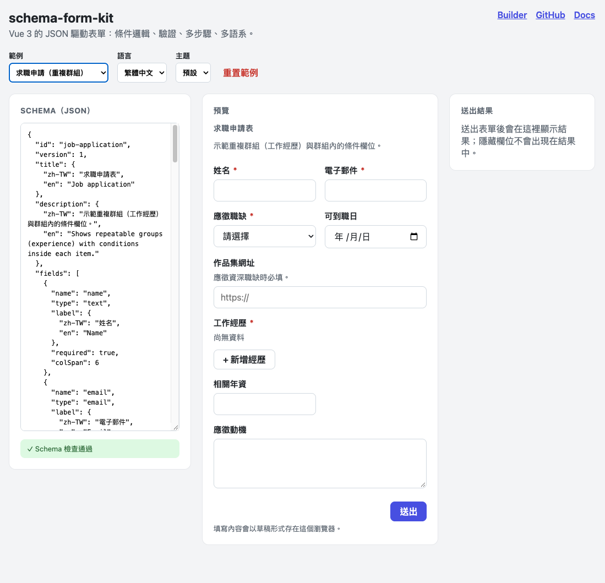

# schema-form-kit

[](https://github.com/juchiang77608/schema-form-kit/actions/workflows/ci.yml)


[](LICENSE)

JSON-driven forms for Vue 3 — conditional logic, validation, multi-step wizards,
repeatable groups and i18n, with a framework-agnostic core and a visual drag-and-drop builder.

| Demo                                                     |                                                       |
| -------------------------------------------------------- | ----------------------------------------------------- |
| [**Builder**](https://forms.janicechiang.dev/#/builder)  | Build a form by drag and drop, then export JSON.      |
| [**Playground**](https://forms.janicechiang.dev)         | Edit the JSON on the left, see the form on the right. |
| [**Documentation**](https://forms-docs.janicechiang.dev) | Guides with live examples and the API reference.      |

> 中文簡介：用一份 JSON 描述表單，就能產生具備條件顯示、驗證、多步驟、重複群組與中英文訊息的 Vue 3 表單。
> 表單規則放在與框架無關的 `core` 套件，UI 由 `@schema-form-kit/vue` 負責。

## Screenshots



| Builder preview                                                          | Playground                                                               |
| ------------------------------------------------------------------------ | ------------------------------------------------------------------------ |
|  |  |

## Packages

| Package                                                  | Description                                                                                                                          |
| -------------------------------------------------------- | ------------------------------------------------------------------------------------------------------------------------------------ |
| [`@schema-form-kit/core`](packages/core)                 | Schema types, condition engine, validation, i18n, schema checks. No runtime dependencies.                                            |
| [`@schema-form-kit/vue`](packages/renderer)              | `<SchemaForm>` component, field components and the headless `useSchemaForm` composable.                                              |
| [`@schema-form-kit/builder`](packages/builder)           | Visual builder UI: palette, drag-and-drop canvas, property panel, steps, undo/redo, import/export, preview.                          |
| [`@schema-form-kit/builder-core`](packages/builder-core) | Editing operations for the visual builder: add, move, rename (with reference updates), change type, steps, undo/redo, import/export. |
| [`playground`](apps/playground)                          | Live editor: edit the JSON on the left, see the form on the right.                                                                   |
| [`docs`](apps/docs)                                      | Documentation site (VitePress) with live examples.                                                                                   |

## Quick start

```bash
pnpm add @schema-form-kit/vue @schema-form-kit/core
```

```vue
<script setup lang="ts">
import { ref } from 'vue';
import { SchemaForm } from '@schema-form-kit/vue';
import '@schema-form-kit/vue/styles.css';
import type { FormSchema } from '@schema-form-kit/core';

const schema: FormSchema = {
  id: 'contact',
  version: 1,
  title: 'Contact us',
  fields: [
    { name: 'email', type: 'email', label: 'Email', required: true },
    {
      name: 'topic',
      type: 'select',
      label: 'Topic',
      options: [
        { label: 'Sales', value: 'sales' },
        { label: 'Other', value: 'other' },
      ],
    },
    {
      name: 'detail',
      type: 'textarea',
      label: 'Tell us more',
      required: true,
      visibleWhen: { field: 'topic', op: 'eq', value: 'other' },
    },
  ],
};

const values = ref({});
</script>

<template>
  <SchemaForm v-model="values" :schema="schema" locale="en" @submit="console.log" />
</template>
```

## Features

- **Field types:** text, email, textarea, number, date, select, radio, checkbox group, switch, repeatable array groups.
- **Conditions:** `eq`, `neq`, `gt`, `gte`, `lt`, `lte`, `in`, `notIn`, `includes`, `empty`, `notEmpty`, combined with `all` / `any` / `not`. Used for `visibleWhen` and conditional `required`.
- **Cascading visibility:** a field that depends on a hidden field is hidden too, and hidden answers are never submitted ([ADR 0002](docs/adr/0002-hidden-fields-cascade.md)).
- **Validation:** required, length, range, pattern, item counts, and named custom validators. Messages in 繁體中文 and English, overridable per rule.
- **Wizard:** `steps` turns the form into a multi-step flow that validates each step before moving on.
- **Array items:** conditions inside an item read sibling fields first (e.g. "end date" only when "current job" is off).
- **Accessibility:** labels bound to inputs, `aria-invalid`, `aria-describedby`, error lists with `role="alert"`, focus moves to the first error.
- **Theming:** every color, radius and spacing is a CSS variable.
- **Extensible:** replace the component for any field type, or build your own UI on `useSchemaForm`.
- **Schema checks:** `checkSchema()` reports duplicate names, unknown condition references, empty option lists, invalid patterns and step mistakes.

## Development

Requirements: Node.js 24 (`.nvmrc`), pnpm 10 (`corepack enable`).

```bash
pnpm install          # first run creates pnpm-lock.yaml — commit it
pnpm dev              # playground at http://localhost:5173
pnpm docs:dev         # documentation site at http://localhost:5173
pnpm test             # unit + component tests (Vitest)
pnpm typecheck
pnpm lint
pnpm build            # packages + playground
```

Or open the repository in GitHub Codespaces; the dev container installs everything.

## Architecture

```
packages/core        pure TypeScript — what the form means
  types.ts           schema types
  conditions.ts      condition evaluation
  fields.ts          visibility, steps, initial values, effective values
  validation.ts      rules and messages
  schema-check.ts    static schema checks
packages/renderer    Vue 3 — how the form looks
  useSchemaForm.ts   headless state: values, touched, steps
  SchemaForm.vue     form shell, stepper, footer
  FieldRenderer.vue  label, description, errors, picks the field component
  fields/*.vue       one component per field type
packages/builder-core  pure TypeScript — editing operations for the builder
  operations.ts      add, move, rename (with reference updates), change type, steps
  history.ts         undo/redo with merged typing
  io.ts              import with checks, export
packages/builder     Vue 3 — the builder UI
  useBuilder.ts      selection, drag and drop, history
  FormBuilder.vue    toolbar, palette, canvas, property panel, preview
apps/playground      live JSON editor + preview, and the builder at #/builder
apps/docs            VitePress documentation site
```

Decisions are recorded in [`docs/adr`](docs/adr).

## Roadmap

- [x] Core engine, Vue renderer, playground
- [x] Builder logic (`builder-core`): editing operations, reference-safe rename, undo/redo, import/export
- [x] Visual builder UI: drag and drop, property panel, condition editor, steps, preview
- [x] Documentation site (VitePress)
- [ ] File and address field types
- [ ] End-to-end tests (Playwright)
- [ ] Publish to npm

## License

MIT © Janice Chiang
